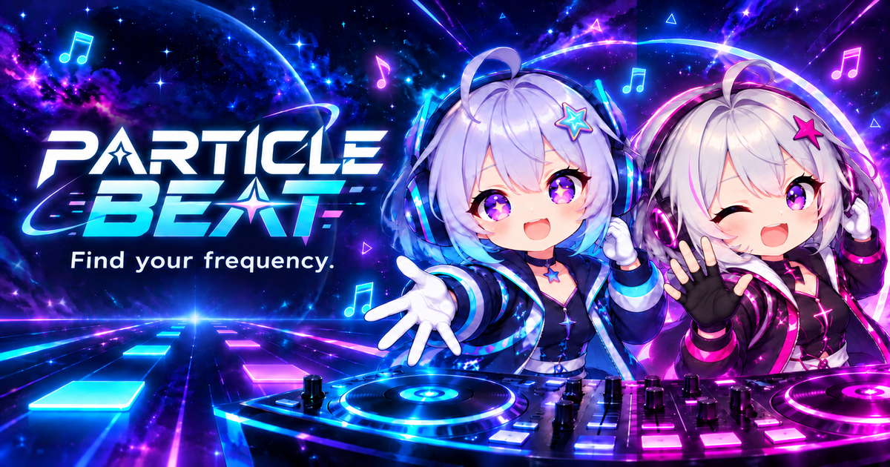

# Particle Beat — Cosmic rhythm arcade

Particle Beat is a browser rhythm game: hit falling notes at the judgement line, sustain HOLD notes, and build your score while keeping your health above zero. Play twenty original two-minute tracks with four or six lanes, accompanied by reactive cosmic effects and your choice of LUMI or NOVA. It runs as a static HTML, Canvas 2D, and Web Audio game on desktop and touch-capable browsers.

**[Play Particle Beat](https://hyangdan2.github.io/CDXPilot0004/)** · [Player guide](docs/GAMEPLAY.md) · [Verification history](docs/VERIFICATION.md)



_LUMI and NOVA, your reactive co-pilots. Promotional illustration; not a gameplay screenshot._

The public address returned HTTP 200 on October 20, 2026; live gameplay was not verified in this documentation update.

## Features

- **Two collections, 160 charts:** SIGNAL 1 / ORIGINAL and SIGNAL 2 / CHALLENGE each contain ten tracks, with EASY, NORMAL, HARD, and EXPERT charts in both lane modes. Each collection remembers its selected song.
- **TAPs and stationary HOLDs:** all charts require at most two simultaneous inputs. EXPERT adds sustained notes; SIGNAL 2 also includes them on HARD. Patterns stay the same on retries.
- **Survival or practice:** STANDARD ends when health reaches zero. FREE PLAY continues through misses and allows health recovery until the song ends.
- **Adjustable timing and presentation:** 0.5–10× scroll speed changes note travel without changing music tempo or judgement windows. Calibration, separate Master/Music/SFX volumes, reduced motion, and effect quality settings are available.
- **Local records:** completed runs compete on named top-ten boards separated by track, lane mode, difficulty, play mode, and chart revision. Export/import backups let you move records between browser origins.
- **Reactive co-pilots:** LUMI and NOVA respond to hits, misses, health, and results. Character choice and visibility are cosmetic preferences.

## Controls

| Input | Action |
| --- | --- |
| **D F J K** | Hit lanes left to right in 4-key mode |
| **S D F J K L** | Hit lanes left to right in 6-key mode |
| **Escape** or on-screen pause/resume | Pause or resume a run |
| Tap inside a lane | Hit that lane in touch mode; tapping the moving note itself is unnecessary |
| Keep the original key/finger held in one lane | Maintain a HOLD through END |
| **Space** in calibration | Tap along with the calibration clicks |
| Arrow keys / Home / End on SIGNAL tabs | Switch track collections |

SETTINGS → INPUT MODE offers AUTO, TOUCH, and KEYBOARD; physical keyboard input remains available in every mode. Touch layout supports portrait and landscape, with a compact highway above the score/character HUD. The HUD does not accept lane input. Moving a finger does not create a new TAP; leaving a HOLD's lane or lifting early breaks it permanently.

## How to Play

1. Open **TRACK SELECT**, choose a SIGNAL and song, then select 4/6 keys and difficulty. Start with EASY; choose FREE PLAY in settings to practice without terminal failure.
2. Press **START**. The selected saved MP3 loads and decodes before the 3/2/1/GO countdown. Hit notes as they reach the judgement line: PERFECT is within 50 ms and GOOD within 120 ms; misses reduce health and reset combo.
3. For a HOLD, press its start on time and keep the same key or finger held until END. Later checkpoints score automatically. A failed HOLD causes one MISS and one health penalty; re-touching cannot repair it. Use your other input for companion TAPs.
4. Finish the 120-second track to receive results, or reach zero health in STANDARD to fail. Use **RETRY** on results or **RESTART** from pause to begin again. Losing window focus pauses automatically.

Resume uses a 2/1/GO countdown. Re-hold any intact active HOLD during that countdown. Only completed runs qualify for records; a new first-place score offers a name prompt. Settings and records persist locally, with session-only fallback when storage is unavailable. There are no accounts or online leaderboards. See the [player guide](docs/GAMEPLAY.md) for scoring, health values, backup limits, and mobile zoom recovery.

## Getting Started

Use **Node.js 22+** for the documented local tooling and a browser with Web Audio (`AudioContext`), Canvas 2D, and ES module support. From the repository root:

```sh
npm start
```

Open **http://127.0.0.1:8765/**. The equivalent command is `node scripts/serve.mjs`. No dependency installation, API keys, external services, or build step is required. Use HTTP rather than opening `index.html` with `file://`.

There is no separate production build or output directory: the repository's static files are the game. Any suitable static HTTP server can serve them. To preview hosting under a repository subpath:

```sh
BASE_PATH=/CDXPilot0004 PORT=8766 node scripts/serve.mjs
```

Open **http://127.0.0.1:8766/CDXPilot0004/**. The server binds to `127.0.0.1`; `PORT` and `BASE_PATH` are optional local-server settings.

## Development

| Command | Purpose |
| --- | --- |
| `npm test` | Run logic, simulated input/audio, all-library replay, storage, metadata, and static HTTP path checks |
| `node tests/library.js` | Validate all twenty scores and 160 charts, including timing, spacing, occupancy, and complete simulated replays |
| `node tests/pages-paths.js` | Check exact-case assets and HTTP loading under two repository prefixes |
| `npm run generate:library` | Regenerate the catalog and chart JSON after score/chart changes; does not render audio |
| `node scripts/verify-audio.mjs` | With FFmpeg installed, analyze MP3s against WAV masters and write verification results |
| `node scripts/verify-character-frames.mjs` | With FFmpeg installed, measure sprite-cell artwork margins |

`npm test` needs no browser installation or npm dependencies. Its HTTP checks start and close servers on ephemeral ports. Separately, serve the project and open `/tests/` for browser logic checks, `/tests/browser.html` for the real-time audio/render audit, and `/tests/result-layout.html` or `/tests/mobile-hud.html` for layout fixtures. Keep the audio audit visible. Synthetic input and mock audio graphs do not establish physical-device latency or listening quality.

### Project structure

| Path | Responsibility |
| --- | --- |
| `index.html`, `css/` | Screens, dialogs, desktop/mobile layout, and sharing metadata |
| `js/` | Gameplay, audio transport, rendering, input, settings, records, and score definitions |
| `assets/beatmaps/`, `assets/tracks.json` | Saved revisioned charts and catalog |
| `assets/music/`, `assets/characters/`, `assets/branding/` | Local soundtracks, co-pilot sprites, and sharing/icon artwork |
| `scripts/`, `tools/` | Static server, generation, optional audio authoring, and asset verification |
| `tests/`, `docs/` | Automated checks, browser fixtures, contracts, and verification history |

Audio time is authoritative; Game alone mutates scoring and health. Production plays saved MP3s and shares one soundtrack across all eight charts for each track. See [architecture](docs/ARCHITECTURE.md), the [harness](docs/HARNESS.md), and the [audio authoring procedure](assets/music/README.md) before changing these contracts. Optional audio authoring has additional dependencies; they are unnecessary for gameplay.

## Deployment

The repository is prepared for static GitHub Pages hosting at the play link above, with a root `.nojekyll` file. No checked-in CI or deployment workflow is present. The documented owner setup is **Settings → Pages → Deploy from a branch**, selecting the intended branch and **/(root)**, not `/docs`. With branch publishing configured, updates to that source are published by Pages; the repository's actual remote settings were not inspected here.

Publish the static entry point, CSS, JavaScript, catalog, all charts, local MP3s, character/branding assets, and `.nojekyll`. There is no generated `dist/` artifact. For a fork or renamed public site, update canonical/Open Graph/social image URLs in `index.html` and the expected URL in `tests/sharing.js`; runtime asset paths are relative. See [branding guidance](assets/branding/README.md).

Export local records before changing browser origin, then import them at the destination; storage is origin-scoped, not repository-path-scoped. Local HTTP checks do not prove successful deployment or live browser gameplay. This documentation update did not publish or change hosting settings.

## Documentation and Limitations

- [Player guide](docs/GAMEPLAY.md): full track list, HOLD rules, scoring, settings, touch behavior, and record backups.
- [Contributor rules](AGENTS.md), [architecture](docs/ARCHITECTURE.md), and [design decisions](docs/DECISIONS.md).
- [Verification harness](docs/HARNESS.md) and [checks actually performed](docs/VERIFICATION.md).
- [Music provenance and authoring](assets/music/README.md), [character provenance](assets/characters/README.md), and [branding provenance](assets/branding/README.md).
- [MIT license](LICENSE).

The current scope is twenty 120-second songs and 160 revision-6 charts. It is a single-player game with keyboard/touch input; no gamepad support, multiplayer, accounts, or cloud saves are implemented. Local records can be edited by the device owner and are not cheat-resistant. Clearing browser data removes them unless backed up.

Twenty deployment MP3s total approximately 48 MB; selection downloads one track and playback retains one decoded song. Artwork includes generated character sheets; provenance and crop limitations are documented above. Physical iOS Safari/Android Chrome acceptance, current browser layout fixtures, listening balance, and perceived audio synchronization remain unverified in this update. Browser/OS zoom overrides cannot be forcibly reset; zoom recovery detection requires VisualViewport. Automated checks are not a supported-browser certification.
